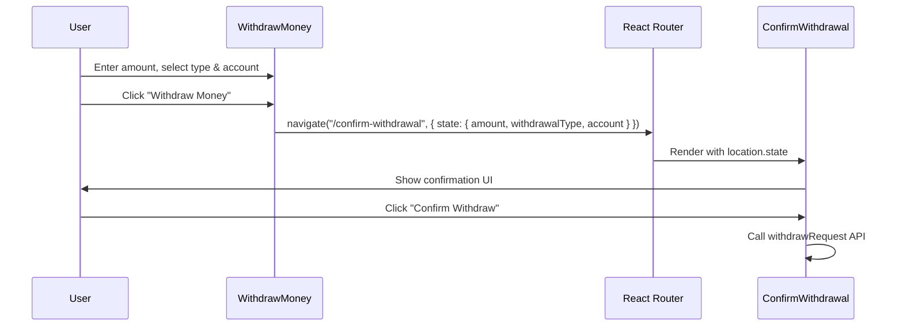

# Design Document: Withdraw Confirm Redirect

## Overview

This change modifies the `WithdrawMoney.jsx` component to act purely as an input-collection screen. Instead of executing the withdrawal API call directly, it navigates to the existing `/confirm-withdrawal` route, passing the user's selections via React Router navigation state. The `ConfirmWithdrawal.jsx` component already handles the API call and is set up to receive the expected state shape.

The change is minimal and localized to `WithdrawMoney.jsx`. No new components, routes, or API endpoints are needed.

## Architecture

The current flow is:

```
WithdrawMoney → withdrawRequest API → Toast + navigate back
```

The new flow is:

```
WithdrawMoney → navigate("/confirm-withdrawal", { state }) → ConfirmWithdrawal → withdrawRequest API
```



## Components and Interfaces

### WithdrawMoney.jsx (Modified)

Changes:
1. **Remove** `useWithdrawRequestMutation` import and usage.
2. **Replace** `handleWithdraw` body: instead of calling the API, call `navigate("/confirm-withdrawal", { state: { amount: Number(amount), withdrawalType, account: selectedAccountObject } })`.
3. **Remove** `isWithdrawing` from button disabled logic and button text.
4. Button always shows "Withdraw Money" with chevron icon.

The disabled logic becomes:
```jsx
disabled={!amount || !selectedAccount || Number(amount) <= 0 || Number(amount) > walletBalance}
```

The `handleWithdraw` function becomes:
```jsx
const handleWithdraw = () => {
  const selectedAcc = accounts.find((a) => a._id === selectedAccount);
  if (!selectedAcc || !amount || Number(amount) <= 0 || Number(amount) > walletBalance) return;
  navigate("/confirm-withdrawal", {
    state: {
      amount: Number(amount),
      withdrawalType,
      account: selectedAcc,
    },
  });
};
```

### ConfirmWithdrawal.jsx (No Changes)

Already expects `{ amount, withdrawalType, account }` from `location.state`. No modifications needed.

### Paths.js (No Changes)

Already has `CONFIRM_WITHDRAWAL` route defined at `/confirm-withdrawal`.

## Data Models

### Navigation State Shape

The state object passed via `navigate` to `/confirm-withdrawal`:

```typescript
interface WithdrawalNavigationState {
  amount: number;           // Raw numeric amount (e.g. 5000)
  withdrawalType: string;   // "instant" or "standard"
  account: BankAccount;     // Full bank account object from the accounts list
}

interface BankAccount {
  _id: string;
  accountNumber: string;
  ifscCode: string;
  accountHolderName: string;
  bankName: string;
  branchName?: string;
  accountType?: string;
  isPrimary?: boolean;
  verificationStatus?: string;
  bankImage?: string;
  logo?: string;
}
```

This matches the shape already consumed by `ConfirmWithdrawal.jsx`.


## Correctness Properties

*A property is a characteristic or behavior that should hold true across all valid executions of a system — essentially, a formal statement about what the system should do. Properties serve as the bridge between human-readable specifications and machine-verifiable correctness guarantees.*

### Property 1: Navigation carries correct state

*For any* valid numeric amount, any withdrawal type ("instant" or "standard"), and any selected bank account object, clicking the Withdraw button should call `navigate` with path `/confirm-withdrawal` and a state object containing `{ amount, withdrawalType, account }` where `amount` equals the numeric value entered, `withdrawalType` equals the selected type, and `account` equals the full selected account object.

**Validates: Requirements 1.1, 1.2, 1.3, 1.4, 1.5**

### Property 2: Button disabled for invalid inputs

*For any* combination of amount and account selection state, the Withdraw button should be disabled if and only if: the amount is empty, or the amount is zero or negative, or the amount exceeds the wallet balance, or no bank account is selected.

**Validates: Requirements 3.1**

## Error Handling

This change simplifies error handling on the WithdrawMoney page:

- **No API errors**: Since the page no longer calls the withdrawal API, there are no network error states to handle. All API error handling remains in `ConfirmWithdrawal.jsx`.
- **Validation errors**: The existing inline validation messages (amount exceeds balance, invalid amount) remain unchanged.
- **Missing account guard**: The existing guard in `ConfirmWithdrawal.jsx` (`if (!amount || !account) navigate("/withdraw-money", { replace: true })`) handles the case where a user navigates to `/confirm-withdrawal` without proper state.

## Testing Strategy

### Unit Tests

- Verify that `useWithdrawRequestMutation` is not imported or called in `WithdrawMoney.jsx`.
- Verify the button text is always "Withdraw Money" (never "Processing...").
- Verify the button does not reference any `isLoading`/`isWithdrawing` state.

### Property-Based Tests

Use a property-based testing library (e.g., `fast-check`) with a minimum of 100 iterations per property.

- **Feature: withdraw-confirm-redirect, Property 1: Navigation carries correct state** — Generate random valid amounts (positive integers within balance), random withdrawal types, and random bank account objects. Render the component, simulate clicking withdraw, and assert `navigate` was called with the correct path and state.
- **Feature: withdraw-confirm-redirect, Property 2: Button disabled for invalid inputs** — Generate random combinations of amount (empty, zero, negative, over-balance, valid) and account selection (none, valid). Assert the button's disabled attribute matches the expected validation logic.

Both unit tests and property tests should be run together. Unit tests cover specific static checks and edge cases; property tests cover the universal behaviors across all valid input combinations.
